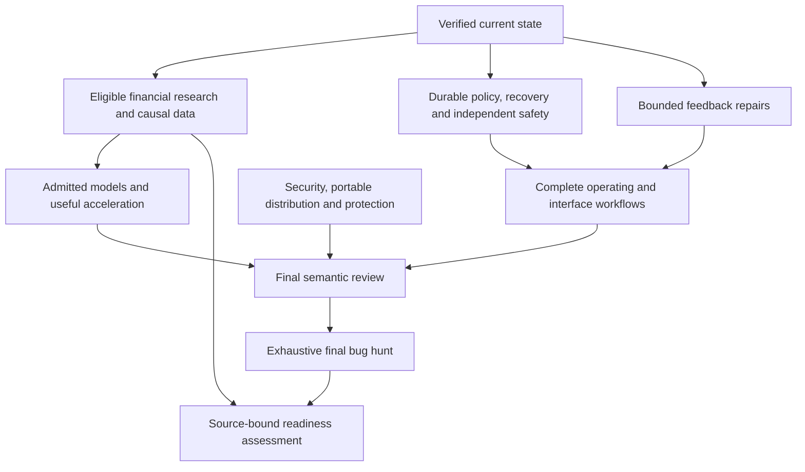

# Active development plan

This plan executes within the existing full trading-platform goal. It preserves
profitable, persistent structural-edge R&D on Polymarket and Binance, the whole
application/model/data/interface revamp, complete capital protection, commercial
distribution work, final whole-repository semantic review and exhaustive bug
hunting. Completing a work package does not complete that goal. The user alone
decides release; this plan never creates a release, draft or tag.

`ASSESS-01` records the source-bound assessment, this plan, its requirement map
and integration with the existing agent entry point. It does not claim another
implementation, market observation or completed trading strategy.

The [current assessment](REPO_STATE_2026_11_11.md) binds the November 11 production
baseline, its later checkpoint addendum and observed problems. The [work graph](DEVELOPMENT_WORK_GRAPH.json)
contains task IDs, acceptance dependencies and next-work routing. The
[revamp map](REVAMP_2026_11_09.md), [work priorities](WORK_PRIORITIES.md),
[capital architecture](CAPITAL_PROTECTION_ARCHITECTURE.md), exact capture contracts
and current registry remain controlling within their scopes. Historical evidence
is preserved, and a source-bound result overrides an unsupported plan assertion.

## Execution in the existing agent harness

1. Verify current HEAD/worktree, applicable instruction revisions and any owned
   live process handles. Classify the preceding turn as progress, verified wait
   or no progress under the existing protocol.
2. Select one bounded work package. An eligible informative financial decision
   has priority; a demonstrated capital/security failure can preempt it. The
   default next local batch is `SAFE-02`; `BASE-01` and `EXEC-01` have recorded
   partial implementations. Do not infer that every research trigger is closed
   merely because no new one is asserted here.
3. Read the selected package and its exact current source/evidence dependencies.
   Reuse previously reviewed material only under the exact-hash rule. Mandatory
   semantic navigation precedes broad source searches; exact known scopes remain
   appropriate for direct lookup. Do not dump this whole plan or all old handoffs
   into every continuation.
4. State the decision or behavior the batch will change. Freeze any sensitive
   source/model/economic choices before access. Establish output, compute,
   timeout, ownership and terminal-failure limits before expensive work.
5. Implement or investigate the full selected behavior, including recovery and
   failure handling. Use focused checks whose scope actually covers it. Reuse
   unaffected receipts; broaden testing when changed assumptions, failures or
   unresolved integration justify it.
6. Retain exact evidence and update the relevant task state with its real source
   revision, outcome, limitations and next condition. Batch coherent changes for
   official connector publication with identity/tree/parent/lease audit. Avoid
   status-only commits, extra PRs and repeated unchanged remote checks.
7. Reap every owned helper and verify teardown. Continue the highest-value ready
   work. A gated source/account/provider branch does not block independent work.
   Only the full completion audit can close the overall goal.

Work-in-progress is one active agent work package under the current no-subagent
rule. Work streams share outputs and the same goal; no parallel agents, new chat,
standing automation, host service, scheduler or startup hook is created. A later
explicit change in agent authority requires deliberate coordination and source
ownership, not an inference from this graph. Dependency edges describe delivery
acceptance; useful independent preparation may proceed without claiming the
dependent deliverable finished.

## Next delivery milestones

Planning refresh: inspected production source
`4ce19f8c5ad7fa1f2c51342c94854ae2792f0ee2`. Existing package statuses and
historical evidence remain separate from these future deliverables. This is a
dependency order, not a calendar estimate or a promise of permanent profit.

| Milestone | Concrete next output | Acceptance and stopping decision |
| --- | --- | --- |
| M1 — Financial decision, continuously first | `FIN-01`: adjudicate the already retained official routing documents; resolve one eligible Polymarket source/payoff question or record the exact missing trigger | Retain native failures and scope limits. A documentation result changes only its source claim. If no eligible economic access follows, close that question and move to useful independent work; do not fetch another quote population to manufacture progress. |
| M2 — Admission across the actual dispatch boundary | `SAFE-02` with `EXEC-02` preparation: map policy checks from strategy evaluation to ordinary and paired Binance dispatch; implement one complete final-admission path | Recheck the required policy revision and relevant state under the authoritative dispatch guard. Changed/missing policy, Stop, expired intent or changed scope prevents new native dispatch; originally owned reduction and UNKNOWN reconciliation remain available. Other callers remain explicitly unqualified until integrated. |
| M3 — Independent safety slice | `SAFE-01` with `EXEC-01`: connect one contained strategy worker to a deterministic session gateway and independent useful-progress observer | A real worker hang, parent exit or stale proposal cannot keep opening authority. Demonstrate bounded teardown, retained uncertainty and available owned recovery through the actual path. No host service or persistent launcher. Start preparation now; do not wait for all UI forms or advanced policy fields. |
| M4 — Economically usable data and baseline | `DATA-01`, `MODEL-01`, and applicable `FIN-02/03`: select one source-qualified objective and feasible comparator | Bind units, clocks, information availability, quantities, all costs, capital and chronological roles before fitting. If the target is a proxy, native coverage is absent or optimistic economics already fail, retain that decision and change the research question instead of expanding training. |
| M5 — Model and acceleration improvement | `MODEL-02`, `ACCEL-01`: compare a simple admitted baseline with an ensemble/local model and any justified LLM contribution on the same roles | Require incremental net utility, calibration/tail behavior, latency and usable capacity. Qualify the installed accelerator and precision first. Keep an accelerator only when it improves useful end-to-end throughput; larger datasets must add independent information. |
| M6 — Complete operator product | `OPS-01`, `UI-01`, `ARCH-01`, `SEC-01`, `DEPS-01`, `DIST-01`, `IP-01` | Finish guided safe setup/recovery, both venues' truthful status, accessible UI and portable isolated installation. Reconcile scanner coverage, compatible locks and obsolete branches. Validate packaging through a path that cannot create a release. |
| M7 — Final qualification | `REVIEW-01` → `BUG-01` → `QUAL-01` | Complete revision/range-bound semantic coverage, then exhaustive fault hunting and supported-profile acceptance. Financial qualification is independent and still required for both venues. Produce the readiness assessment; only the user may authorize release. |

### Financial decision protocol

Maintain separate Polymarket and Binance frontiers. Prefer a question with a
clear economic consequence, admissible evidence and a small decisive next
step. Compare information gained and total acquisition/implementation cost;
do not assign invented probabilities or a numerical value-of-information score.
A source-complete rejection can be more useful than another ambiguous fit.

For Polymarket, prioritize exact outcome/settlement identities, collateral and
cash availability before probabilistic residual claims. Bind observation
intervals, cancellation/dispute rules, fees, selected-side depth, locked capital,
execution sequence and worst-case orphan exposure. An apparent cover is not a
cash guarantee when its contracts settle on different events or clocks. The
holding-yield branch requires its exact independent refresh trigger; a new date
or general instruction to continue does not satisfy it.

For Binance, separate financed carry/convergence from execution savings on
independently necessary flow. Carry requires actual funding cash, borrow and
collateral feasibility through stress, rather than direction prediction or a
leveraged ROI denominator. Routing requires matched final inventory/cash after
commissions, conversion spread, residuals and failure costs. A venue mechanism
with unproved API access or execution capacity is a source lead, not a strategy.

For either venue, passive-fill claims need admissible execution evidence or
valid bounds; aggregate L2 and hypothetical queue positions are insufficient.
Direction-independent payoff mechanics can still lose through financing,
liquidity, basis, settlement, software or counterparty risk. Specify abstention
when costs, state or evidence fail; do not promise all-regime positive returns.

Each research batch records: exact decision, universe/access trigger, available
information, comparator, same-unit net cash/capital law, selection budget,
validation roles, adverse scenarios, process/data/output budget and terminal
action. Freeze outcome-sensitive choices before access. Read retained bytes
first where admissible; keep every consumed population and historical result.
Promotion requires independently evaluated after-all-cost utility, recurrence,
capacity and risk evidence under the controlling acceptance contracts.

### Work selection and resource discipline

- Keep one active implementation/research package. Reassess financial priority
  at a meaningful package boundary or a material new fact, without repeatedly
  polling unchanged triggers. A demonstrated capital/security defect can preempt.
- Start supervisor and writer-map preparation from the already accepted Stop,
  enrollment, recovery and scoped-policy interfaces. Full package dependencies
  still govern completion; they do not require finishing every advanced field,
  UI form or venue before an independent synthetic integration slice can start.
- Set a concrete output and stopping condition before each batch. If it cannot
  change a decision or user-visible behavior, defer it. If a source/provider is
  gated, record the exact resume condition once and select independent work.
- Reuse unchanged test/source receipts. Run one affected-domain checkpoint after
  behavior converges; broader suites are for changed shared contracts or final
  integration, not every edit. Inventory counts, syntax scans and test passes
  are separate from financial qualification and semantic review.
- Keep one current overview and graph; update only superseded current claims.
  Add detailed evidence when it is needed to reproduce a decision, not another
  transcript or copy of an unchanged controller. Batch coherent publications.
- Use bounded, hidden, session-owned processes and verified teardown. Observe
  resource lifetime during repeated work. Other tasks remain untouched; only
  performance-timing conclusions depend on material contention checks.

The graph's `next_actions` makes these first decisions explicit for subsequent
continuations. Entries are routing instructions inside the existing goal, never
a scheduler or permission to run a gated capture/account/order operation.

## Immediate batches

| Order | Package | Concrete outcome | Boundary |
| --- | --- | --- | --- |
| Continuous priority | `FIN-01` | One genuinely informative financial decision whose literal evidence/access gate is satisfied | No routine re-sampling, speculative probability or promotion-based activity |
| Feedback continuation | `BASE-01` | Three local diagnostic scopes repaired; retained-source Markdown and workflow advisory remain | Preserve old results and frozen source lineage; do not spend an open-ended phase polishing unrelated history |
| Operator continuation | `EXEC-01` | Spot inspect → bounded collection → retained application is implemented; guided forms, futures/legacy application and rearm remain | No order replay, implicit credentials, automatic rearm or actual account request during synthetic development |
| Next safety slice | `SAFE-02`, with `SAFE-01` and `EXEC-02` preparation | Final admission and an independent supervised gateway slice, then all-writer acceptance | Keep the owned reduction path outside a frozen strategy process; preparation does not grant opening authority |
| Research/model admission | `DATA-01`, `MODEL-01`, `FIN-02/03` as applicable | Causal economically meaningful inputs and independent utility/capacity evidence | More rows, larger models and high GPU usage do not supply missing evidence |

This delivery view shows shared dependencies; it does not start parallel agents
or schedule processes:

### BASE-01 — Restore useful feedback without changing the economic record

The [first repair phase](review/2026-11-11/feedback-repair/review.md) passes the
affected cases and local Ruff, terminology and Vulture scopes. Historical text
bindings are now content-specific. Markdown/workflow issues and hosted/full-suite
acceptance remain open. Continue `EXEC-01` without repeatedly running these
unchanged successful scopes or turning historical formatting into a broad phase.

Use the retained exact-commit logs: four terminology findings, 13 Ruff import
diagnostics, nine unused-parameter diagnostics, nine Markdown diagnostic instances
and the low workflow advisory. Separate current authored claims/code from inert
publisher extracts and historical before-state evidence. Inspect each signature,
entry point and suppression before changing it. Preserve source bytes required
by frozen studies through their immutable provenance; do not silently invalidate
their implementations or rewrite numerical results.

Deliver a small root-cause repair batch and an explicit scope reconciliation.
Current financial claims must still fail when unsupported. Callback signatures
and actual invocation paths must still work. Review current official workflow
semantics before changing the self-repository syntax. No blanket ignore, disabled
analyzer or lower economic gate counts as a fix. Re-establish a useful broad
test baseline only after the preceding blockers are resolved; record new failure
families rather than treating the historical 86 as current. Independent economic
research and urgent capital repairs can proceed alongside this bounded work.

### EXEC-01 — Complete operator recovery

The [operator collection phase](review/2026-11-11/recovery-workflow/review.md)
connects pending inspection, bounded reads, cached reuse and retained Spot
application through the real parser/handler and generated expert contract.
Original request bindings are rechecked before reads, and uncertain read/retention
outcomes remain explicit. Futures/legacy application, guided native forms, account
qualification and controlled rearm still require their own acceptance. Continue
`SAFE-02` for the durable policy/recovery contract needed by the larger workflow.

Extend the existing `recover-close` workflow to inspect an unresolved original
request even before terminal evidence exists, then explicitly collect that
order's status/fills and apply retained evidence separately. Bind original
venue/product/key scope and exact request/evidence digests. Load configured
credentials only for an explicitly requested new read after local admission;
never use history/logs or put secrets in arguments/output. Cached evidence
must remain local and must not imply a fresh account query.

Expose truthful distinctions between no read, attempted/unknown read, completed
response, retained evidence and applied inventory. Test timeout, process exit,
partial/zero fills, stale/mismatched scope, changed storage, post-commit errors,
repeat invocation and resource release through the real command path. Preserve
ownerless Stop and UNKNOWN obligations. Add guided native selection only after
the backend contract is sound. Futures/legacy recovery, lost-owner migration
and explicit rearm require their own verified continuation stages.

### SAFE-02 — Durable risk policy and recovery state

The [enrolled loss-policy phase](review/2026-11-11/capital-policy/review.md) binds
signed autonomous evaluation to explicit scope/unit/reference/limit revisions
in the existing execution journal. The [procedure](BINANCE_CAPITAL_POLICY.md)
preserves Stop, cash history and owned reduction. Universal writer/final-intent
integration, complete policy fields and the remaining state contract below are
still required; the active loss-policy hash is not a full gateway qualification.

The [cash-peak repair](review/2026-11-11/cash-peak-risk/review.md) fixes a reproduced
Binance capital-admission defect: retracement of settled gains was treated as zero
drawdown while lifetime PnL stayed positive. The guard reconstructs that scoped
peak from existing retained history, so a restart does not clear it. This adds no
policy store or activation authority. Full marked high-water, day baselines,
external cash movements, policy/model/generation binding, reservations, quarantine
and explicit rearm remain required below. Polymarket behavior is unchanged.

Define a versioned policy contract separate from transactional mutable state,
using existing authoritative ledgers rather than another competing store. Cover
scope, units, allocation/exposure, leverage and margin headroom, order/rate/price
limits, cash/fee reservations, realized and valid marked losses, drawdown,
source age, clock limits, useful-progress deadlines, resources and model health.
Do not guess the user's future live capital or loss tolerance; defaults keep
new live exposure disabled.

Persist policy/model/generation identity, Stop epoch/reason, reservations,
loss/high-water state, pending orders, reconciliation and quarantine across
restart. Define day rollover and external cash movements without resetting
loss budgets. Activation, migration, backup/restore and rearm need explicit
validated transitions. Missing/corrupt/replaced/rolled-back state must not create
fresh authority. Qualification includes interrupted updates and recovery, with
the remaining coordinated-rollback threat stated precisely.

### SAFE-01 — Independent session supervisor and gateway

Implement the architecture already specified in the capital roadmap: a small
session-owned supervisor, a deterministic credential-bearing execution/risk
gateway and terminatable strategy/model workers. The supervisor must observe
completed useful work and reconciliation independently of a worker heartbeat.
Proposals carry generation, sequence, expiry, source/policy/model identity and
owned intent. Bounded queues and backpressure prevent stale or repeated orders.

Keep emergency control, ledger reconciliation and owned reduction outside the
strategy job being terminated. Qualify hangs in numerical/native/network work,
parent death, abandoned generations, queue saturation and shutdown. On Windows,
assign owned children to containment before allowing execution. This is an
application session architecture; it installs no persistent machine service.
Job containment is not a credential-security sandbox.

### EXEC-02 — Fence every native writer and qualify owned execution

Create a source-bound inventory of every entry, close, cancel, replace,
roundtrip, redemption, SDK and alternate transport caller. Map each to account,
scope, intent, reservations, policy, gateway generation and reconciliation.
Route legitimate new risk and owned reductions through their distinct authority
paths; remove accidental direct-write bypasses through verified adapters.

Qualify account UID/key rotation, exact symbol filters, fee assets/cash,
collateral and availability rather than deriving them from a key fingerprint
or local positive wealth. Prove one complete paper/testnet lifecycle, including
partial/UNKNOWN acknowledgements, restart, terminal recovery, owned closing and
explicit rearm. Actual authenticated operations still need current secure
credentials and their separate endpoint/scope authority. Testnet economics do
not qualify mainnet fees or capacity.

### FIN-01 — Select informative financial R&D continuously

Read the affected full registry row, canonical contracts, terminal results and
every retry conjunct. Select a distinct source-complete question that changes
an economic decision. Reuse admissible retained bytes for explicitly labeled
exploration before spending another request. Source discovery, rule/payoff
identity, rejection-only economics, executable costs/capacity and independent
recurrence are separate stages with explicit stopping consequences.

Prefer persistent cashflows, exact payoff relationships and execution savings
with legitimate existing flow. Keep expiring incentives as historical records.
For each candidate, specify same-unit/same-horizon cash, capital, financing,
fees, orphan/failure stress and the feasible abstention/liquidation alternative.
No source-completeness failure is a negative expected-value theorem. No positive
snapshot, quote proxy, testnet gain or unfilled maker queue is stable profit.

### FIN-02 — Carry, financing and capital feasibility

Complete native paired quantities, funding entitlement, spot prefunding and
remaining locks, financed inventory, derivative collateral, haircuts, transfers,
liquidation and settlement clocks for an eligible strategy profile. Preserve
the negative annual and consumed weekly evidence; lower hurdles or a leveraged
reference scenario cannot turn them into new validation.

Deliver a source-bound cash/capital path with feasible equal-initial-wealth
comparators and continuous solvency stress. Only a profile with positive
after-all-cost headroom and an independently eligible evaluation can advance.
Required account terms may be provided by appropriately authorized/redacted
evidence where sufficient; missing fields remain unknown. This work is a
conditional prerequisite for models that actually use financing or hedges.

### FIN-03 — Residual-payoff and execution-cost opportunities

Use exact-cover certificates to separate a static floor from the remaining
random payoff. For a residual claim, prospectively define the full candidate
universe, probability model, calibration roles, selection budget, cost horizon
and tail/failure allowance. The retained NFL nine-point example supplies no
probability estimate or new book authority. Dual pricing weights cannot be
used as empirical probabilities or labels.

For execution overlays such as venue-managed routing, require independently
necessary legitimate flow and compare matched final proceeds/received inventory
against the feasible direct alternative, including commission assets, spread,
partial completion and unwind. API/testnet support and eligibility must be
source-proved. Deliver an independent net-utility/capacity result or a precise
abstention condition; do not build a collector merely because a mechanism exists.

### DATA-01 — Causal data and provenance

Audit the particular dataset required by the chosen economic objective: native
transport modes, timestamp units, snapshot availability, independent clock
offsets, duplicates/gaps, event identity, label completion and selected-side
liquidity. Preserve partial/UNKNOWN data explicitly. Aggregate L2 cannot identify
owned passive fills; use valid bounds or independently qualified execution
evidence instead of manufactured fill labels.

Produce versioned manifests, coverage/selection history and chronological roles
before fitting. Add independent useful observations only when they improve the
information needed for the objective. Keep immutable source/results and the
completed storage migration intact; do not reread a large dataset just to
reassure an unchanged manifest or reopen protected captures.

### MODEL-01 — Economic targets and valid evaluation

Define targets as causal incremental net utility against feasible abstention,
liquidation or hedging, with fixed quantities, actual/qualified cost laws, cash
availability and relevant capital. Record every searched model/feature/policy
variant and the full selection budget. Keep calibration labels strictly before
evaluation decisions; use chronological purging and an untouched final role.

Qualify sample dependence, calibration and tail uncertainty. Existing score/rank
heuristics must not be called calibrated statistical confidence. Require actual
incremental after-cost utility, usable capacity and risk behavior; classification
accuracy alone cannot promote a trading model. Matching a cost-law tag is only
compatibility, and historical artifacts remain unchanged.

### MODEL-02 — Stateful models, multimodel systems and LLMs

After target/data admission, compare simple economic baselines with useful local
models and ensembles. Evaluate stateful inventory/turnover, uncertainty,
abstention, expected residual payoff where relevant, drift and delayed labels.
Use controlled ablations to identify useful contribution before increasing
model complexity or dataset scale.

Integrate LLM/web context as source-bound evidence or separately tested review
signals. External text is untrusted. LLMs cannot alter deterministic authority,
disable Stop, fabricate prices or block owned closing. Measure incremental
utility, latency, failure and operating cost. Quarantine and candidate retraining
do not grant automatic promotion or rearm. Record the actual model/backend
identity when exposed; a claimed model name is not review evidence.

### ACCEL-01 — Useful GPU acceleration and throughput

Discover actual host/backend capabilities without changing other applications
or drivers. Qualify a supported isolated backend/profile, versions, precision,
resident execution and CPU/GPU output/economic parity. The last Windows Torch
cohort's CPU-only result is not permission to abandon every other supported
route; the DirectML or other suitable route requires its own current evidence.

Profile the admitted workload, then improve batching, data layout, transfer,
warm-worker reuse and computation where they change throughput. Scale datasets
for independent coverage and learning information. Seek efficient GPU use
without sacrificing control responsiveness or creating useless work. Timing
needs CPU/GPU/RAM/disk context; defer only when contention is material, not until
the whole PC is idle. Never terminate another task, purge its cache or reset
its GPU. Installation or utilization percentage does not establish speed or
accuracy improvement.

### OPS-01 and UI-01 — Operator behavior and all application surfaces

Build a coherent source-bound status/diagnostic contract across CLI, terminal
and native UI: venue/product/account scope, paper/simulated/observed evidence,
units, data age, model/gateway generation, owned positions, native costs,
unknown obligations and actionable recovery. Keep operational diagnostics
available during model or network failure.

Finish guided setup, research/training, trading, Risk, Data, System and Settings
flows using real backend contracts. Preserve immediate Stop and stale-state
denials. Verify keyboard/focus, screen-reader/accessibility, resizing/scrolling,
supported DPI, empty/error/loading states and both venue modes. Use bounded
hidden previews while the user sleeps; never activate windows or repeat
black-frame probes. Design/image tools may support a visual decision; generated
returns, balances or charts must not masquerade as evidence.

### ARCH-01 — Refactor through verified seams

Map lifecycle and ownership before extracting modules from the large CLI,
recorder, training, publication and execution files. Separate product handlers,
research protocols, reusable economic kernels and immutable evidence. Create
neutral process/HTTP interfaces and explicit minimal dependency profiles where
cross-venue coupling currently increases setup cost.

Preserve public command/receipt contracts through adapters and focused parity
checks. Apply coherent naming, comments, typing, errors, units, logging and
resource ownership. Fix demonstrated slow/unsafe paths rather than splitting
files to satisfy a size metric. Frozen historical runners need reachable exact
source provenance before any current wrapper changes.

### SEC-01 and DEPS-01 — Security, dependencies and branch hygiene

Reconcile the three current CodeQL analysis results with actual alert
disposition using supported metadata/SARIF contracts; review justified existing
suppressions. Triage validated findings by exploitability and program impact,
fix mechanisms and verify exact-commit acceptance. Inspect credentials, IPC,
HTTP, deserialization, paths, dependency/build/update boundaries and shipped
assets. Never pull plaintext secret-alert bodies merely to count alerts.

DeepSource is quota-gated: skip scans/retries until independent availability
evidence changes. Keep successful CodeQL analysis, open-alert inventory, disabled
coverage, rate limits and billing quota separate. Review current compatible
publisher/package metadata and hash locks in an owned isolated candidate cohort.
Do not force incompatible NumPy/websocket/accelerator upgrades or modify another
environment. Preserve the known-good cohort until affected compatibility passes.
Audit the two superseded bot branches before cleanup; do not merge their older
pins or create replacement PRs unnecessarily.

### DIST-01 and IP-01 — Portable installation and commercial boundary

First provide a validation path that performs zero release/tag/draft mutations;
the current release composite is not that path. Test supported same-OS/architecture
clean-host installation, missing dependency provisioning from reviewed locks,
uninstall/upgrade, offline/driver failure and CLI/native parity. Discover or
accept configured tools/paths instead of assuming a developer installation.

Select and measure a protected distribution boundary: compiled proprietary
modules/selective protection versus a deliberately chosen service architecture.
Keep development source readable and preserve MIT/third-party obligations;
license, visibility, hosting and release decisions are not silently changed.
Inventory shipped/nested files for source, bytecode, maps, debug symbols, model
and research assets; qualify signing/update and private matching diagnostics.
Protection or service failure must not disable Stop, reconciliation or owned
reduction. No intrusive anti-debugging or unstealable-code claim follows.

### TOOLS-01 — Efficient agent and tool operation

Maintain one current plan and work graph, concise handoffs and exact receipt
reuse. Avoid duplicate dated controllers, repeated tool catalogs and raw log
dumps into model context. Use actual source-bound semantic retrieval for broad
navigation, mandatory admitted page research and concise internal communication.
Inspect relevant official marketplace capabilities when they fill a real task
gap; retain decisions and finish the remaining capability audit without
installing everything or opening chooser windows.

Treat tool/input/runtime limits explicitly and use bounded data transfer.
Optimize index/context/workflow cost when a measured bottleneck or repeated
failure justifies it; preserve every source/evidence gate. No claimed token,
speed or accuracy saving is accepted from a proxy count alone. Every repeated
or long-lived change needs process/memory/resource-lifetime evidence. Keep
inert evidence separate from processes, services or startup persistence.

### REVIEW-01 — Complete final semantic review and refactor

After the main implementation converges, review every required tracked source,
configuration, instruction, test and document at an exact revision/range. Cover
financial units and assumptions, causal timing, authority, state transitions,
concurrency, numerical limits, failure cleanup, interfaces, packaging and user
flows. An inventory/AST parse is metadata, not a reviewed line.

Keep a coverage ledger distinguishing reviewed text, immutable evidence checked
for provenance, binaries requiring artifact inspection, protected/unread inputs
and unresolved findings. Reopen changed coverage. Preserve previous results;
never silently exclude unread material and then claim the whole repository
reviewed. Apply justified homogeneous refactors and record the actual review
model/profile where available, with no invented “latest model” attestation.

### BUG-01 — Exhaustive final bug hunting

Run the user's final intensive campaign after the main revamp and semantic
review. Use adversarial sequence/property tests and real contained process
faults: crash boundaries, partial publication, missing/replaced storage,
stale generations, frozen workers, network ambiguity, orphan fills, resource
exhaustion, shutdown/restart and rollback. Include native UI/launcher,
serialization, timing/clock discontinuity, fee/quantity extremes, migrations,
clean-host packaging and model-health failures.

Reconcile every supported profile and every outstanding failure from the
baseline. Validate physical reboot/power-loss scenarios at the appropriate
controlled stage; do not substitute a cooperative shutdown test. Fix causes,
reopen affected review and rerun the necessary acceptance scope. No blanket
suppression, coverage padding or unsafe financial-gate relaxation is acceptable.

### QUAL-01 — Product and financial qualification

Require complete paper/testnet lifecycle acceptance, supported installation/UI
profiles, scoped security/dependency evidence, resource teardown, final review
and bug-hunt closure. Financial qualification separately requires positive
after-all-cost utility with capacity, appropriate capital/tail controls,
independent chronological recurrence and explicit abstention for the requested
Polymarket and Binance strategies. Retain negative results and uncertainty.

Publish an exact-source readiness assessment and reproducible evidence, not a
completion percentage inferred from task counts. Any unverified requirement
keeps the overall goal open. A ready assessment authorizes no release or live
money; the user retains those separate decisions.
