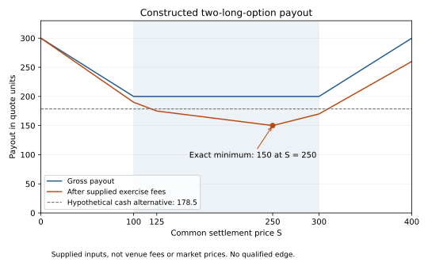

# Two fully paid long options: exact conditional cash floor

The inspected parity discovery covers vertical/convexity relations and four-leg
boxes. This research lead instead combines a lower-strike long call with a
higher-strike long put. It contains no short option, spot or perpetual leg.
Under a common linear quote-cash settlement law and matched base quantity `q`:

`q * [max(S - K_low, 0) + max(K_high - S, 0)] >= q * (K_high - K_low)`

The lower bound holds for every nonnegative common settlement price `S`, without
a directional forecast. Outside the strikes, payout increases. It is a payout
floor, not a fixed payout or a profitable entry price. Buying both claims can
cost more than their minimum eventual payment. Source qualification must also
establish fully paid treatment; the mathematical construction cannot establish
actual account margin, encumbrance or liquidation rules.

The gross terminal identity is also a cash amount `q*(K_high-K_low)` plus
`q*max(K_low-S,0)` and `q*max(S-K_high,0)`. Those positive tail claims can cost
money upfront. The construction does not create an acquisition discount or a
yield advantage over an available cash investment merely by rearranging claims.

## Exercise fees can move the minimum between strikes

The new research-only `option_long_floor` evaluates a supplied fee on each leg:
`min(index_rate * S, intrinsic_cap_fraction * positive_intrinsic)`.
Rates, caps, quantity and the terminal cost/rounding reserve are explicit inputs.
No Binance fee coefficient is hardcoded or admitted from search snippets.

The payoff is piecewise linear. Its only kinks are zero, the two strikes and
valid call/put fee-switch points. With fee coefficients in `[0,1]`, the final
tail has nonnegative slope. Evaluating these at most five exact rational points
therefore finds the all-state minimum; a price grid or Monte Carlo is unnecessary.
Nonterminating switch prices remain exact, independent of Decimal precision.

An intentionally synthetic example uses strikes 100/300, unit quantity, index
fee 0.1 and intrinsic cap 0.5. These are constructed coefficients, not venue
terms. The gross floor is 200. Checking only the strikes suggests a minimum
after-fee payment of 170, but the actual supplied-law minimum is **150 at 250**.
An endpoint-only calculation would overstate the floor by 20 quote units.

Even that positive payout is not profit: with hypothetical upfront debit 175
and an equal-capital alternative multiplier of 1.02, the incremental floor is
`150 - 175 * 1.02 = -28.5`. A second counterexample gives the call settlement
price 0 and put settlement price 400: both pay zero. Common settlement cannot
be inferred from related asset labels or omitted when clocks/rules differ.
These are algebraic controls, not observed prices or independent validations.

Reproduce with the local [renderer](render.py) and [control generator](controls.py).
Exact rational values in [controls.json](controls.json) are authoritative. Both
scripts use the project environment and require a new `--output`
path. The plot is explanatory, not an economic test.

## Native source gate failed; no market request followed

Three prospectively selected Binance primary FAQ captures attempted buyer
margin treatment, option payoff law and fee law. All returned native success
but HTTP **202**, with only one extracted character each. Each fails the frozen
HTTP-200 and substantive-content gates. The exact native outputs, preflight,
controller and durable journal remain preserved. No locale retry, challenge
bypass, substitute page reader or source-gate relaxation followed.

Consequently no Binance-specific fee, fully paid margin treatment, settlement
law, account eligibility or executable floor is qualified. Search excerpts
selected sources only. No option metadata, price, depth, funding, account,
credential or order was requested, and no protected data was opened. The
[source-bound result](result.json) preserves these separate phases.

## Reuse and next decision

All **31** focused supplied-law checks pass, including an interior minimum,
nonterminating rational arithmetic, unequal fees, degenerate switches, tails,
quantity/reserve units and malformed inputs. The evaluator always returns
`qualified_edge: false` and has no trading or model-promotion integration.
No unchanged engine suite, expanded fit, GPU training or timing benchmark ran.

This is a distinct unpriced construction related to option research, not a
reinterpretation of the consumed single-option/opposite-perpetual results.
Preserve their exact triggers, 2,944-symbol exclusion union and all newer
restrictions. Do not reprice or reuse those exhausted populations for this lead.
Before any economic capture, admit primary product/fee/settlement scope, freeze
a separate genuinely new population and candidate selection, and compare
complete acquisition cash with the net floor and a feasible equal-capital
alternative. Require every fee, tick, rounding, orphan, custody/tax, settlement
delay, capacity and recurrence qualification; simultaneous quotes are not
atomic fills. No repeated sampling until a winner is permitted.

The earlier [completion baseline](../../2026-09-05/completion-decision-review.md)
already exists. Its selected 66 historical lock rows still lack decision-time
liquidation/depth/fee evidence and cannot train the requested model. That work
was routed and preserved rather than rebuilt or relabeled.

Registered counts remain **204 observations / 65 hypotheses / 37 scoped
mechanisms / 0 qualified stable edges**. No market observation or accepted scope
is added by a supplied-law proof or failed documentation capture.
