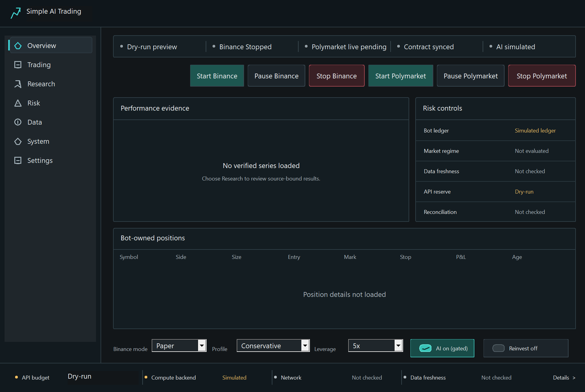
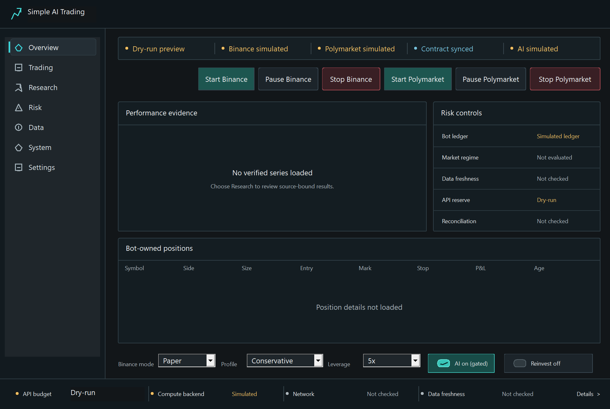
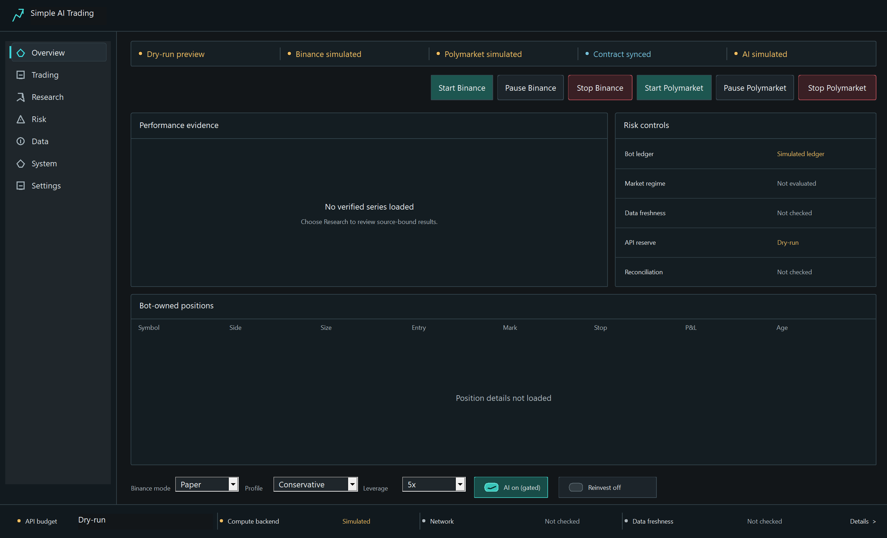

# Native operator control and status review

The reviewed baseline is `215c2f6b277958c81fdfb8009bde0f33abfa9121` plus the
separately recorded Round21 scoring repair. The native Overview was rendered
from the actual Release executable in hidden dry-run mode at 1280 × 860 and
1680 × 1020 device-independent pixels. Each owned preview and interaction
process exited. The review preserved the existing visual system.

## Observed flow and repair

1. The baseline Overview presented a simulated Binance runtime as stopped
   and left Polymarket pending. The revised status strip explicitly identifies
   both venue runtimes as simulated. Simulation is amber and an observed
   command-contract match is blue. Recorded runtime states have typed labels
   and tones, including Stop latched, control unavailable and unknown values.

2. A real hidden-window command sequence reproduced a lost Stop request.
   Polymarket Pause and Stop shared one busy flag. While Pause was delayed,
   clicking Stop changed the label but the busy guard discarded the command.
   Pause now has its own worker flag, allowing Stop to dispatch independently.
   Window shutdown accounts for both workers.

3. A second hidden-window sequence delayed Stop. Subsequent Overview Pause
   and Start requests were rejected before dispatch. Both venues have these
   guards. The exercised sequence used Polymarket. Two backend regression
   cases also confirm that late Pause or Resume cannot weaken its persisted
   Stop epoch, reason or paused state.

4. Local command dispatch displays Sending Stop or Sending Pause. Status
   refreshes carry a control revision, preventing a sample started before a
   control action from replacing its newer label. Active control workers also
   suppress competing refresh labels. Missing or unsupported runtime values
   resolve to unavailable.

## Visual evidence

The minimum-size baseline and revised render use the same dimensions and
retained screenshot mechanism. The larger revised render was also inspected.
Controls and status labels fit at both inspected sizes.

## Verification and limits

The native Release presentation executable passed. The focused preview and
Polymarket runtime-control modules passed **53 cases in 6.21 seconds**. The
separate Round21 scoring lane passed 85 cases. The combined evidence binds
their exact source hashes without repeating those tests.

The old build cache combined incompatible compiler and standard-library
versions. A fresh isolated build selected the installed matching MSVC
19.52.37029.0 compiler and headers, using two build workers. Initial build
failures and subsequent successful logs remain in private evidence.

Hidden interaction probes exercised actual window handlers with simulated
CLI responses. They establish dispatch and local control ordering. They do
not establish exchange execution, position flatness, heartbeat freshness or
capital safety. Running state and Stopped state describe recorded values.

This review covers the Overview and the specific interactions above. Keyboard
navigation, screen-reader behavior, every page and every display configuration
remain unqualified. Full independent supervision, hard worker deadlines and
complete final-dispatch fencing remain open product work.

The [sealed evidence](evidence.json) binds native source and executable hashes,
screenshots, actual command-output logs, focused verification and the semantic
navigation receipt. Raw logs and local probe scripts remain outside Git.
