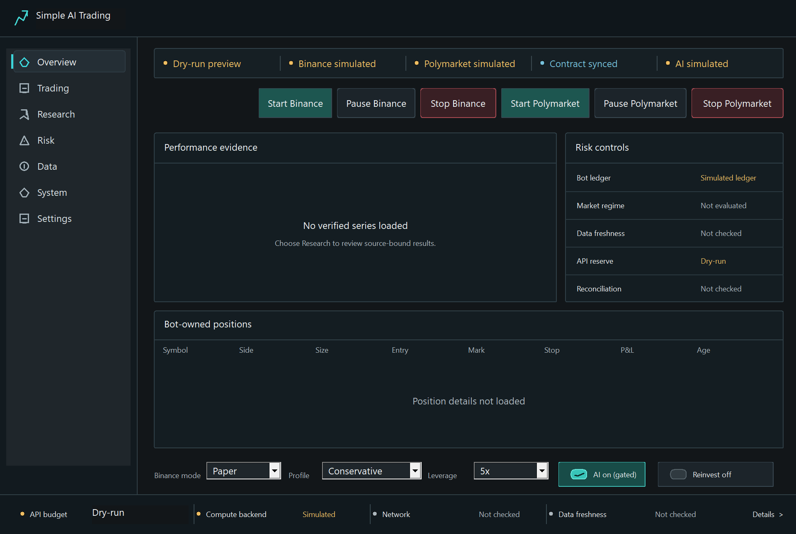
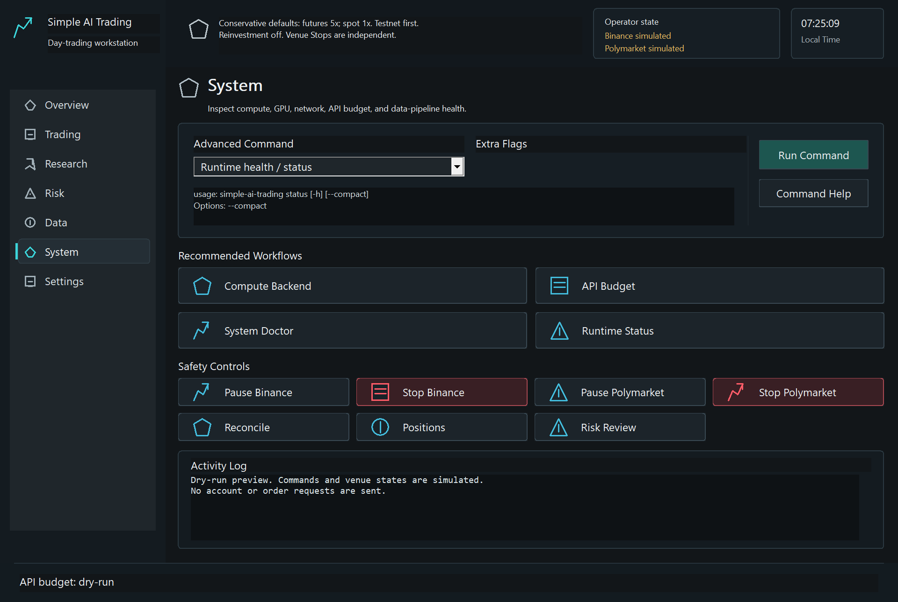
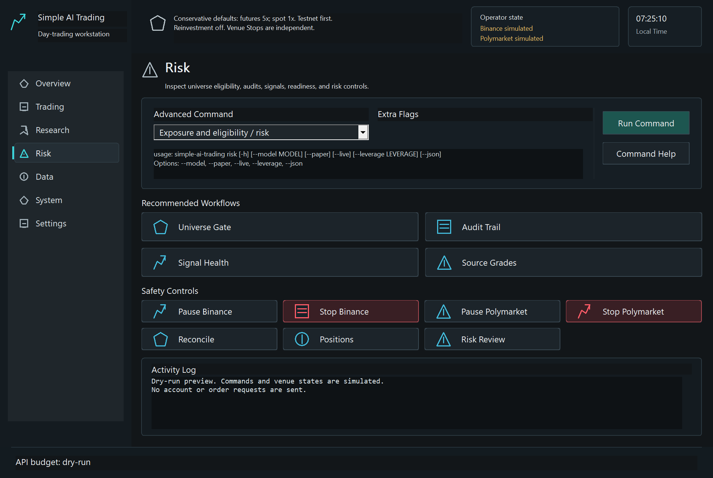

# Native operator workspace audit

System and Risk clipped command help and placed the activity console across
diagnostic controls and the footer at the supported minimum client size. The
header clipped its Binance state and omitted Polymarket. This checkpoint repairs
those observed defects without qualifying financial performance or live control.
The baseline is `c5f66017f6d02369ae18b6099146684b927af6ca`.

## Inspected steps

These are separate page exports, not a claim that keyboard navigation or a
production trading workflow was exercised. Each actual Release client was
rendered in-process while hidden, using dry-run responses, then exited inside
its owned process job. Every final image was opened and reviewed before use.
The dimensions are **1280 by 860 DIPs, 1920 by 1290 pixels at 150% scale**.

1. **Overview: visually sound within this scope.** Simulation and unknown data
   remain explicit. No balances, positions or return series were invented. Its
   final PNG is byte-identical to this audit's baseline Overview.

   

2. **System: reproduced layout defects repaired.** Command help, workflows,
   independent venue controls, diagnostics, activity log and footer are now
   separate. Both simulated venue states are legible in the header. The page
   remains a command launcher; the screenshot does not establish fresh backend,
   GPU, network or capital-health measurements.

   

3. **Risk: reproduced layout defects repaired.** The selected risk command's
   usage and options are readable, the activity heading no longer covers
   diagnostics, and both venue Stops remain visible. The frame does not establish
   actual portfolio risk, position ownership or completed reconciliation.

   

## Implementation

Painting and native child controls now consume one shared section geometry.
Workflow cards use the available width while retaining sufficient room for the
activity log at the minimum size. Minimum tracking size includes window chrome,
so it represents the intended client-area minimum. Command help and activity
output are read-only, vertically scrollable controls. Initial control fonts are
applied after creation as well as after font rebuilding; the old startup path
assigned the body font to every control.

The non-Overview header displays both venue observations with their typed tones.
One shared presentation function marks simulated venue values on every page.
The decorative Configure box was removed; Settings remains in navigation. Button
icons center within their actual bounds. Dry-run startup text describes simulation
instead of including workstation paths; ordinary startup diagnostics are unchanged.

The bounded exporter now selects an exact page, passes only a narrow system
environment and requires a matching native page receipt. Missing, oversized or
wrong-page receipts reject before retaining a PNG. Unknown page requests and
preview requests without dry-run fail before window creation. There is no
foreground activation, desktop capture or fallback to an uncontained child.

## Verification and limits

The Release presentation executable passed status and geometry cases, including
both sides of the workflow-width breakpoint. **61 focused Python cases passed**,
covering preview validation/cleanup, Windows process-job ownership, launcher
contracts and generated CLI/native parity. Two independent native invocations
returned exit 2 for unknown-page and missing-dry-run requests, without an output
frame or page receipt. Ruff passed for changed Python files. The source remained
unchanged across these checks. Exact hashes and raw-log digests are in the
[sealed evidence](evidence.json); originals and build/test logs remain private.

Visible accessibility risks from clipped text and overlapping controls were
repaired at the inspected size. Text labels accompany state colors and Stop
controls. Keyboard order, screen-reader names, high-contrast mode, scrolling
interaction, multiple-monitor DPI transitions and every other page/state remain
unqualified. Mathematical geometry checks at other dimensions do not substitute
for screenshots or interaction there. No universal accessibility claim follows.

Financial retry triggers were not established by this audit. Discovery-only
search results were not admitted as source content, and no source/market capture,
account request, venue order, model fit or benchmark was performed. The canonical
frontier remains 206 observations, 65 hypotheses, 37 historical scoped mechanisms
and **zero qualified stable edges**. The full application and R&D goal remains
active; this is one repaired operator boundary.
